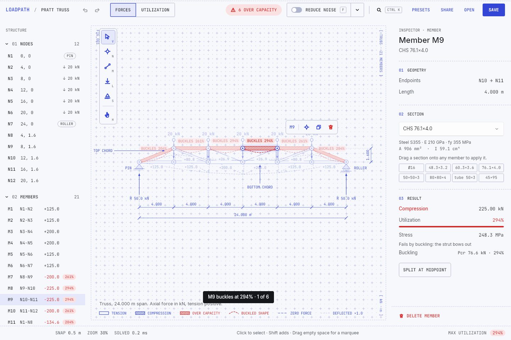
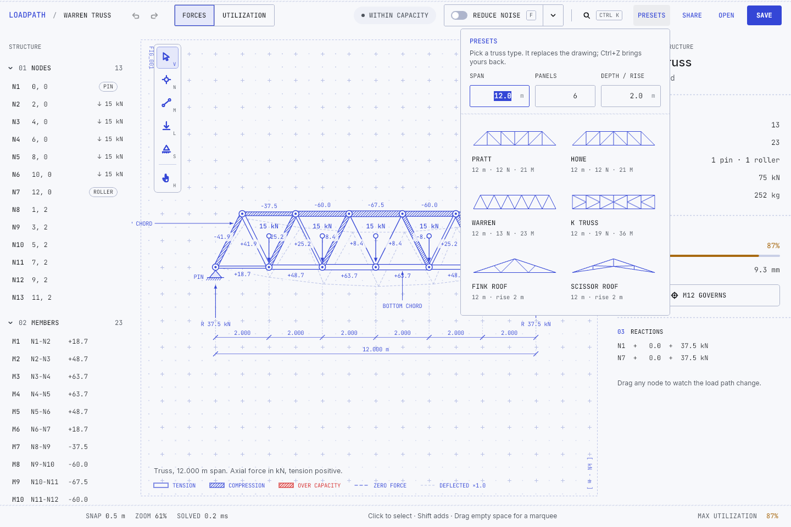

# Loadpath

- **Owner:** Matthew Mattei (@noknowscode)
- **Status:** ready for review
- **What it is:** A 2D truss workbench that solves as you draw: forces, utilization and deflection follow every drag.

A desktop workbench for 2D trusses that solves as you draw. Place nodes, connect them, pin some to the ground, hang loads, and every member shows the force it carries, its utilization, and the deflected shape. Drag a node and the whole load path re-solves on every pointer move.

Built with Uno Platform (`Uno.Sdk 7.0.5`, Skia renderer, SkiaSharp 4, the Simple theme of Uno Themes with the design's palette in `Styles/ColorPaletteOverride.xaml`) for four heads: desktop (Windows, macOS and Linux through Skia), WebAssembly, Android and iOS. It follows the system theme (a light blueprint sheet or a dark drafting table), lays itself out for phones, tablets and desktops, and edits by mouse and keyboard or by touch. The product and interaction design are in [`SPEC.md`](SPEC.md); this file covers what shipped, how it is built, and how it was validated.


## Run

```powershell
dotnet build Loadpath/Loadpath.csproj -f net10.0-desktop -p:LoadpathTargetFrameworks=net10.0-desktop
dotnet run --project Loadpath/Loadpath.csproj -f net10.0-desktop -p:LoadpathTargetFrameworks=net10.0-desktop
```

`LoadpathTargetFrameworks` limits the app to one head, so a build needs only that head's workload. This folder holds the one app project Studio opens; the unit tests (xunit) live in the development repository, [noknowscode/loadpath](https://github.com/noknowscode/loadpath), and cover the page model, the container, the engine, the tools, the document session and Core. Warnings fail the build (`TreatWarningsAsErrors`), except trim analysis, which reports only on Uno's and MVUX's generated code. The other heads: `net10.0-browserwasm` (`wasm-tools` workload), `net10.0-android` and `net10.0-ios` (macOS). The development repository's CI builds all four.

In Debug, set `APP_NO_HOTDESIGN=1` to skip `UseStudio()` when no DevServer is reachable (headless runs).

## What it does

| Capability | How it shows up |
|---|---|
| Live analysis | Direct stiffness solve on every edit, sub-millisecond for the samples. Status chip in the title strip, max utilization in the status bar. |
| Force ribbons | Member width scales with axial force; copper is tension, steel-blue is compression, and compression members carry a dark core line so sign is never color-alone. Overstressed members turn red with hatch ticks. |
| Tools | `V` select, `N` node (click a member to split it), `M` member (chains; click empty space to add a node), `L` load (click for 10 kN down, drag from a node to aim), `S` support (cycles pin → roller → none), `H` pan or hold `Space`. |
| Selection | Click, `Shift`-click, marquee (`Alt` selects what touches), `Ctrl+A`. The floating bar above a selection offers support, load, split, duplicate, delete. |
| Manipulation | Drag nodes or members with grid snap, alignment guides, `Shift` axis lock, `Alt` to disable snapping. Arrow keys nudge, `Shift` ×5. Load arrow tails are handles. |
| Inspectors | Summary, node (position, support, load fields), member (section, material, force, stress, utilization bar, buckling check), mixed (bulk actions). Sections drag from the inspector onto members. |
| Outline | Nodes and members with support badges and signed forces; click selects, hover highlights on canvas. |
| Display modes | `1` forces, `2` utilization ramp, `3` deflected ghost (exaggeration ×0.2 to ×3, stepped from the palette; the legend and the layers sheet show it), `4` labels, `5` reactions. |
| Commands | Every action is an `AppCommand` with one shortcut label. `Ctrl+K` opens a searchable palette; right-click opens element-specific menus. |
| Undo/redo | Every mutation is a reversible edit. Drags coalesce into one entry, and Esc mid-drag undoes that drag only. Opening a sample, loading a preset and pasting a design are undo steps too, so none of them asks first. `Ctrl+Z`, `Ctrl+Y`. The history remembers the save point, so undoing back to the saved state clears UNSAVED; branching away from it keeps the document dirty. |
| Persistence | `.loadpath` JSON documents (save, save as, open), view options persisted. The autosave restores on launch with the file the document belongs to and its unsaved changes still unsaved. New, Open and closing ask before dropping unsaved work: a Save / Discard / Cancel dialog on desktop and Windows, the browser's own "leave this page?" prompt on WebAssembly. |
| Share | `SHARE` or `Ctrl+Shift+C` copies a one-line share code (`LP1.` + base64url of the deflated JSON, about 460 characters for the Warren sample). `Ctrl+Shift+V` (or "Paste design" in the palette or empty state) loads a code, a code inside a chat message, or raw `.loadpath` JSON. Pasting is one undo step. Without a clipboard the code goes to `~/Documents/Loadpath/<name>.share.txt` and paste reads it back. |
| Presets | `PRESETS` opens a flyout with Pratt, Howe, Warren, K, Fink and scissor trusses, generated from span, panels and depth (rise for roofs), each with a live thumbnail. A preset ships with supports, panel-point loads (5 kN/m deck for bridges, 2 kN/m for roofs) and sections, so it solves at once. Loading one is undoable; the palette lists each preset at its defaults. |
| Failure highlighting | Members over capacity carry a red pill that names the mode: `BUCKLES 294%` or `YIELDS 118%` (the pill drops the verb when crowded). A member failing by buckling also gets its first Euler mode drawn beside it as a dashed red bow, with a legend entry. The summary inspector lists every failure worst first, with the force against Pcr or the stress against fy; a row selects its member. `J` steps through the failures, with a toast giving the position ("2 of 6"). |
| Upsize | `U`, the inspector's UPSIZE FAILING MEMBERS button, or the palette gives every failing member the lightest library section that carries it below 95 % utilization, as one undo step. A member keeps its material when that material has a working section. Redundant trusses are re-solved and resized until they settle. The toast reports the count and added mass ("Upsized 6 members · +157.3 kg"), and names any member no library section can carry. A passing member changes only if the upsize itself pushes it above 95 % (load moves in a redundant truss); one that was already near its limit and is not made worse keeps its section. |
| Lighten | `Shift+U`, LIGHTEN MEMBERS in the summary inspector, or the palette gives members the lightest same-material section that keeps every member under 95 % (or under its own utilization, if it was already above), as one undo step. It runs only when nothing fails, tries the heaviest members first and re-solves after each change, and leaves zero-force members alone because they often brace the frame. The toast reports the mass saved and the new max utilization: the Warren sample drops from 252 to 128 kg at 89 %. |
| States | Empty-state invitation with three samples, mechanism banner when the structure can move, a warning when parts are not connected to a support (they are left out of the solve instead of failing it), toasts for refused actions. |






## Architecture

```
Loadpath/Core/      the document, the solver and the editing rules, with no UI dependency (namespace Loadpath.Core)
  Model/            StructureDocument, Node, Member, Section, Material
  Analysis/         TrussSolver (direct stiffness), LinearSolver, AnalysisResult, SectionSizer (upsize failing members, lighten the rest)
  Editing/          IEdit, EditHistory (undo/redo, coalescing, transactions), edits
  Selection/        SelectionSet
  Viewport/         Viewport (world ↔ screen, zoom-at-point, fit), PinchGesture
  Geometry/         Vec2, Bounds, HitTester (mouse and touch radii), SnapEngine, GridSteps
  Input/            TouchTracker (tap, drag, long press, pinch arbitration)
  Serialization/    DocumentSerializer (JSON v1, checked whole before anything is built), ShareCode (LP1. text codes), Autosave
  Samples/          Warren, cantilever, Howe roof; TrussPresets (parametric Pratt, Howe, Warren, K, Fink, scissor)
Loadpath/           Uno single-project app
  App, AppServices  the composition root: the host (logging, the theme service) and every service, one instance each
  MainPage          composes the shell, routes shortcuts, reports the layout
  Presentation/     EditorEngine (imperative), EditorModel (the MVUX binding surface and commands) and the pieces that
                    project the editor into its states: StatusProjection, OptionMirror, InspectorProjection,
                    OutlineProjection, PaletteSearch, PresetGallery; DocumentSession (files, share
                    codes, debounced autosave, unsaved-changes question), SettingsSync (saved view options),
                    EditorStartup (settings, then autosave or a fixture), ToastQueue, CanvasLayout (floating bar and sheet
                    geometry), IUiThread, IUnsavedPrompt, DebugFixtures (Debug only), Records, ViewOptions
  Commands/         AppCommand (an ICommand), CommandRegistry (shortcut parsing)
  Workspace/        WorkspaceView (the SKCanvasElement: draws, routes the mouse and the wheel), TouchInput (fingers),
                    RenderSnapshotBuilder, WorkspaceRenderer, RenderSnapshot, ViewFitting and ViewportAnimation (keeping
                    the structure framed), WorkspaceInteraction, Tools/
  Views/            TitleStrip, ToolRail, InspectorPanel, OutlinePanel, StatusBar, CommandPalette, ToastHost,
                    CanvasMenu, CanvasOverlays (the floating bar and what an open sheet covers),
                    SectionDragController, UnsavedChangesDialog
  Controls/         Icon, ToolButton, NumberField, KeySink, KeyboardState (modifier keys), Motion, Sketch, IconLibrary,
                    WrapStack, ThemeLookup, Converters (the utilization bar is a styled ProgressBar)
  Services/         FileService (IDocumentFiles), SettingsService (ISettingsStore), ThemeSwitcher (IThemeService),
                    CloseGuard, DispatcherUiThread
  Styles/           ColorPaletteOverride (the Simple theme's palette, Light and Dark: the file Studio's Themes tab
                    edits), TypographyOverride (the type ramp and the mono family)
  Themes/           Layout (layout sizes no theme token covers, the responsive layout), Icons, Controls (text styles
                    on the semantic styles, the theme's controls with the design's sizes, the app's own templates)
```

**Decision: MVUX for the presentation layer, an imperative engine for the document.** `EditorModel` is a `partial record` whose states and feeds carry immutable records (`EditorStatus`, `InspectorContent`, `OutlineItem`, `PaletteItem`); the generated `EditorViewModel` is the page's DataContext and every view binds with `{Binding}`. Buttons bind generated commands; undo and redo are feed-gated (`Command.Create(b => b.Given(Status).When(s => s.CanUndo)...)`). `EditorEngine` owns the document, undo history, selection, viewport and tools, and raises events the model projects into states, because a solve on every pointer move cannot copy an immutable document per frame. Tradeoff: two layers, and a plain `ViewOptions` mirror of the option states for the renderer. The model's pieces (status, options, inspector, outline, palette, presets) declare their own states and share the model's `SourceContext`: the generated view model binds a state of another context read-only.

**Decision: one container for the app's services.** `App` builds an Uno.Extensions host (`UnoFeatures` `Hosting`, `Logging`, `ThemeService`) and `AppServices` registers the engine, the document session, the settings, the toast queue, the theme switcher, the close guard, the file pickers, the unsaved-changes dialog and the MVUX view model as singletons. The page is created by the frame, so it resolves them from `App.Services` in its constructor, on the UI thread; everything below it takes its dependencies through constructors, and the tests build the same container with their own UI thread and settings store. Code that needs the UI thread (MVUX runs commands off it) goes through `IUiThread`, so the page model runs in the tests. Logging goes through `ILogger`: Debug builds log the app's decisions, `LOADPATH_TRACE=1` adds every key, press and wheel step, Release logs failures; failures that escape every handler are logged and shown as a toast. Tradeoff: the hosting packages add to the WebAssembly payload.

**Decision (proposed, 2026-11-04): a failure nothing else caught keeps the app running.** `App` marks `UnhandledException` handled after logging it and showing a toast, because every edit is in the undo history and the autosave, and closing would drop the session the user can still save. Tradeoff: a corrupt state could outlive the exception; the toast says something went wrong so the user can save and restart.

**Decision (proposed, 2026-11-04): the deflection exaggeration stays a palette command.** README promised a slider that was never built; the copy now says what exists (×0.2 to ×3 in steps of 0.1, shown in the legend and the layers sheet). A slider in the layers sheet is a small follow-up if the owner wants it.

**Decision (proposed, 2026-11-04): a view the user moved is refit only when a narrower window would cut the structure off.** A fitted view follows every resize, as before. A moved view stays where the user put it, unless the whole structure was on the canvas before the resize and part of it is not after it; then it is fitted again. A view the user left partly off the canvas stays theirs. Tradeoff: a narrower window can undo a zoom the user chose.

**Decision (proposed, 2026-11-04): a custom app icon in place of the Uno template's.** The launcher, splash and gallery icon are one mark: a roof truss on a pin and a roller, white on the app's accent (the Light `PrimaryColor` #3446D6), drawn as flat strokes so it reads at 48 px. `Assets/Icons/icon.svg` (the accent square), `icon_foreground.svg` (the mark) and `Assets/Splash/splash_screen.svg` (the mark in the accent on white) keep the template's viewBoxes, so the Resizetizer's foreground scales (1.0 desktop, web and Windows, 0.80 iOS, 0.65 Android) keep it inside each safe zone.

**Decision (proposed, 2026-11-04): the showcase info file points at the sample's future home.** `.studiolive/sample.json` (sample id `loadpath`) gives its icon and screenshots as `https://raw.githubusercontent.com/unoplatform/Uno.Samples/master/studio/loadpath/.studiolive/...`, as the format guide's example does, so they resolve only after the move to Uno.Samples. Whether relative paths can be used instead is the Studio team's question 1 in uno-private#2444. The screenshots were taken from the desktop head at 1280 x 800 and 390 x 844 with the samples the Debug fixtures load (nothing debug-only is in the frame).

**Decision: one `SKCanvasElement` for the workspace, XAML for everything contextual.** Ribbons, labels, supports, guides and adorners must be pixel-registered with the structure, so they are Skia. The floating bar, banners, toasts and the drag ghost are XAML on an overlay layer positioned through the viewport transform. The renderer reads a `RenderSnapshot` built on the UI thread and holds no per-frame allocations beyond paths. There is no `CompositionTarget.Rendering` subscription; viewport animations run a timer only while moving.

**Decision: the Simple theme carries the look; Uno Toolkit for responsive layout.** The visual system is the blueprint drafting sheet (Inter for UI, JetBrains Mono for every number, hairlines instead of shadows), carried by Uno Themes so Uno Platform Studio's Themes tab and any other theme change reach it. `App.xaml` merges `SimpleToolkitTheme` (`UnoFeatures` `SimpleTheme`, `Toolkit`): its `Colors` point at `Styles/ColorPaletteOverride.xaml`, the design's full Light and Dark table on all 33 palette keys; `DefaultFontFamily` is Inter and `FontOverrideSource` (`Styles/TypographyOverride.xaml`) sets the design's ramp (11 12 13 14 22) and `MonoFontFamily`; `DefaultSpacing` 8 and `DefaultCornerRadius` 4 generate the `Space*` and `Radius*` tokens. Pages, styles, converters and the canvas use the role brushes (`OnSurfaceBrush`, `PrimaryBrush`, `OutlineVariantBrush`, `ErrorContainerBrush`...): the structure is drawn in Primary, construction lines are Primary blended into the paper, and failure is Error. The one colour with no role is Warn, the amber step of the utilization ramp, in `App.xaml`'s Light and Default dictionaries. Text uses the semantic styles (BodyMedium, LabelSmall, HeadlineSmall...); SAVE, the links, the outlined actions, DELETE, menus, flyouts, fields, check boxes, the progress bar and tooltips are the theme's styles with the design's sizes. List rows, square icon buttons, the segmented toggles, the reduce-noise switch, the tool button and the number field keep small templates on role brushes (Simple's button templates cannot stretch a row's content, and Simple has no segmented control). `utu:Responsive`, `ResponsiveView` and `utu:SafeArea` keep the title strip, the work area and the status strip inside the phone's visible bounds. Tradeoff: menus highlight with the theme's Primary fill, toolbar buttons are 40 px (were 38) and 14 and 18 px icons are 16.

**Decision: two themes, one identity.** Every palette role has a Light value (the blueprint sheet: paper `#F7F8FB`, near-black ink, blueprint-blue structure) and a Dark one (a drafting table at night: blue-slate paper `#10141B`, chalk ink, the structure in a lighter blueprint blue `#8FA0FF`). Views use `{ThemeResource}` role brushes; the canvas palette and the brush-key converters read the same roles for the window's theme through `ThemeLookup`, re-read them on `ActualThemeChanged`, and again when the theme recolours its brushes after a palette edit. The app follows the system by default; the `⋯` menu (and three palette commands) pin Light or Dark, and the choice is saved with the view settings. Text passes 4.5:1 in both themes (secondary ink 7.3:1 on the light paper). Dark is keyed `Default`, so Windows High Contrast falls back to it instead of failing to resolve.

**Decision: one responsive layout for the workbench.** `Themes/Layout.xaml` defines the app's only `utu:ResponsiveLayout` as `DefaultResponsiveLayout` (Normal 600, Wide 1100, Widest 1240): a docked 336 px inspector needs 1100 px to leave the sheet usable, and the docked outline docks from 1240 px as it always did. Widest shows outline, canvas and inspector; Wide docks the inspector with the outline as its second tab; Normal makes the inspector a side sheet over the canvas; Narrow (phones) turns the tools into a 44 px strip under the drawing, the inspector into a bottom sheet and moves secondary commands into the title's `⋯` menu. `Ctrl+\` and the title's inspector button toggle whichever the layout has. Tradeoff: Loadpath's breakpoints differ from the Toolkit defaults the other samples use.

**Decision: touch edits through the same tools.** A finger behaves like the left mouse button, but its press is held back until it moves (drag), lifts (tap) or rests (long press, the context menu), so a second finger can turn the touch into a pinch-zoom and pan before any tool acts. Fingers hit-test with 22 px radii (mouse keeps 6 to 9 px). A multi-select toggle in the floating bar stands in for Shift, the free-placement tool for Alt.

**Decision: detached parts are tolerated.** The solver finds connected components; a component with no support is excluded and reported instead of making the whole solve singular. A structure that is genuinely a mechanism still reports as one.

## Validation

- Theme pass (2026-11-06): the look moved onto the Simple theme (see Architecture). The theme gate prints OK (no hex outside the palette file and `App.xaml`, no colour literal in C#, no literal font or radius; one literal margin left, the displacement dot's centring). Debug desktop and the Release WebAssembly publish build with 0 errors and no new warnings. Under Xvfb, the four showcase states and the empty, palette, node and member states compare with the previous build in Light and Dark at 1280 x 800 and 390 x 844. With `PrimaryColor` and `PrimaryContainerColor` set to `#C2185B` and the Background and Surface colours swapped in the palette file, every accent (SAVE, links, the wordmark, segments, the active tool, the selection, the structure and its labels on the canvas) and every page and panel followed; a runtime override of the palette recoloured the canvas live. Switching Light to Dark at runtime (the palette command on desktop, the browser's colour scheme in headless Chromium) turned the chrome and the canvas together.
- Pre-transfer cleanup (2026-11-04): unused usings, members, a never-read field, resources (the motion-token dictionary, a text style, eight tokens, one font file) and template leftovers removed, stale comments rewritten or removed; behaviour unchanged. 325 tests pass; desktop, WebAssembly and Android build with 0 warnings; the semantic lint has 0 gating hits; 25.4 automation names per 1,000 XAML lines. The app icon and splash are Loadpath's own mark (see Architecture), and `.studiolive/` holds the showcase info file.
- A pass 2 (2026-11-04, closed scope from the code review): `EditorModel` is 282 lines and each of its pieces under 200; `WorkspaceView` went from 623 to 390 lines (touch input, the frame builder and the view fitting have their own classes). A snapped point on a node selects it, undoing a sample gives the file back, picker failures are logged and the fallback says what it did, and a narrower window refits a view it would cut off. A regression of the model split, found at runtime, is fixed: the view could not write the pieces' states (the palette did not filter, typed fields and the layer switches did nothing). 325 tests pass (261 before). Desktop under Xvfb drove workflows 1-7, the touch path and the refit (`docs/evidence/desktop-refit-after-width-change.png`); the Release WebAssembly build in headless Chromium drove the palette, the presets sheet, J, U, Ctrl+Z and a narrower window (`docs/evidence/wasm-palette-presets-refit.png`). The semantic lint has 0 gating hits; 25.1 automation names per 1,000 XAML lines.
- A pass (2026-11-04): the app's services live in one container (Hosting, Logging, ThemeService) and `MainPage.xaml.cs` went from 764 to 186 lines (see Architecture). 261 tests pass (190 before), the page model and the container among them. The shell stays inside the phone's safe area: the CI emulator dump has the title strip below the status bar (y 177 instead of 49) and the status strip above the gesture bar. The floating bar keeps off the drawing on phones, the tool rail wraps at 844 x 390, input edges are 3:1 in both themes, Tab reaches every control and outline row (59 named stops on Warren), a preset tile loads in one click with a value typed but not entered (desktop and WebAssembly), and failures toast in turn with file names instead of paths. The trimmed Release WebAssembly publish ran in headless Chromium: Warren, then Pratt at 24 / 6 / 1.6 from the presets sheet, J, U and Ctrl+Z (`docs/evidence/`). The semantic lint has 0 gating hits; 25.1 automation names per 1,000 XAML lines.
- uno-audit (2026-11-04, [`docs/UNO-AUDIT.md`](docs/UNO-AUDIT.md)): dead Core helpers, unused usings and two duplicated helpers removed; the canvas menu, the section drop and the palette rows act through the engine and bound commands instead of page code; a failing autosave or settings write is reported instead of swallowed. Release desktop, WebAssembly and Android builds have 0 warnings; 190 tests pass. The semantic lint has 0 gating hits, with every remaining allow comment above a real hit and naming why the replacement does not fit.
- Code review fixes (2026-11-01): Release desktop and WebAssembly builds have 0 warnings and 0 errors with warnings as errors; 183 tests pass (81 new). The autosave records the document's file and its unsaved state: the review's repro (open a file, open a sample, restart, Save) asks where to save instead of overwriting the file, and recovered edits still ask before Open or New drops them. Esc, or a second finger, ends a drag by undoing only what that drag pushed. A sample replaces the document as an undo step. A file, share code or autosave with a duplicate id, a dangling member or a non-finite number is refused whole. Under Xvfb, a value typed into N3's X field followed by a click on N2 moves N3; Esc cancels a section drag. In headless Chromium the WebAssembly build raises the browser's leave-page prompt with unsaved changes, and after a reload restores the autosave unsaved, with the saved display mode.
- Themes, layouts and touch: Release desktop, Android and WebAssembly builds have 0 warnings and 0 errors; 102 tests pass (11 new: touch hit radii, the touch tracker's tap / drag / long press / pinch arbitration, the pinch anchor and clamp). Under Xvfb the Warren sample with a member selected was captured at 360, 599, 600, 800, 1080, 1099, 1100, 1240 and 1920 px wide, Light and Dark, with the inspector sheet closed, open and on its outline tab, each in one launch live-resized through the widths. With `LOADPATH_TOUCH=1` the mouse drove the touch path: a tap 18 px from a node selects it, a long press opens the node menu with 44 px rows, a one-finger drag moves a node, the multi-select toggle adds a second node. The overflow menu, the theme switch, the presets and layer sheets capped to a 360 px window, `Ctrl+\` on a phone, and the close prompt (Cancel keeps the window, Discard closes it) were driven with `xdotool`. Pinch and two-finger pan are covered by unit tests only: `xdotool` has a single pointer. The published WebAssembly build starts in Chromium at 390 x 844 and 1440 x 900 and loads the Warren sample. The WinAppSDK and iOS heads cannot build on Linux and are left to CI.
- Share, presets and failures (Stage 5 of `SPEC.md`): share codes round-trip every sample exactly, decode from inside surrounding text and from raw JSON, and refuse empty, foreign, truncated and corrupt input with a readable reason. Every preset at four parameter sets (defaults, small, odd panel count, 16 panels) solves with no detached parts, spans exactly the requested width, and balances its applied load with its reactions; defaults stay below full utilization; Pratt diagonals are in tension and Howe diagonals in compression. A slender strut fails by buckling, an overloaded tie by yield, and failures sort worst first. Section sizing brings an overloaded Pratt within capacity, changes only failing members in a determinate truss, picks the lightest working section per material, converges on a redundant K truss without leaving a touched or pushed member above 95 %, leaves a passing structure alone and reports loads beyond the library. Lighten saves mass without raising any member past its limit, keeps material and zero-force members, refuses while something fails, converges on a redundant truss, and is idempotent. The undo history's save point is clean after undo or redo back to it, dirty after branching away or extending the saved drag, and survives a history clear. An overloaded timber Fink upsizes in timber and an oversized one lightens in timber. 91 test cases in total.
- Runtime (Stage 5): under Xvfb, an overloaded Pratt (`LOADPATH_PRESET=pratt:24,6,1.6`) shows mode pills, buckled bows, the legend entry and the inspector failure list; `J` cycles with a position toast; clicking a failure row selects its member. The presets flyout was driven end to end (span set to 30 m, K truss loaded, `Ctrl+Z` restored and refit the previous structure). Share → New → Paste round-tripped the Howe roof through the real X11 clipboard, and `Ctrl+Z` undid the paste.
- 21 unit tests: a triangle truss matches method-of-joints forces and reactions to three decimals; a square without a diagonal is a mechanism; detached parts are left out; drags coalesce; delete/split/duplicate revert exactly; samples serialize round-trip and all solve below full utilization.
- Runtime: the app was driven under Xvfb with `xdotool` (`tools/drive.sh`) through select, drag with live re-solve, undo, node and member chaining with guides, load vector drag, support cycling, marquee delete, load-handle drag, number-field editing, outline selection and collapse, bulk support and section actions, section drag-and-drop, the combo box, the palette (search, arrow keys, Enter), context menus, display modes, save to disk and autosave restore. The same pass was repeated after the MVUX conversion. Screenshots in `docs/` come from those runs.
- Release build has zero warnings.
- A UI craft pass (critique checklist, two widths, two heights, every display mode) brought control heights from five values to three (26 px chrome, 24 px status-bar segments, 32 px tool rail), moved arrow labels off the members, added the exaggeration readout, replaced the macOS `⌃K` glyph with `Ctrl+K`, and made the status bar drop the cursor readout below 960 px so the display toggles and max utilization stay whole.

Fixture hooks make headless captures deterministic: `LOADPATH_SAMPLE=warren|cantilever|roof`, `LOADPATH_PRESET=pratt` or `pratt:24,6,1.6` (span, panels, depth), `LOADPATH_RESET=1` (ignore settings and autosave), `LOADPATH_SELECT=n4,m12`, `LOADPATH_MODE=utilization,deflection,reactions,nolabels`, `LOADPATH_TOOL=member`, `LOADPATH_PALETTE=1`, `LOADPATH_TOAST=text`, `LOADPATH_EDIT=unsupported|overload`, `LOADPATH_TRACE=1` (log every key, press and wheel step to the console), `LOADPATH_THEME=light|dark|system`, `LOADPATH_SHEET=1` (open the inspector sheet), `LOADPATH_TAB=outline`, `LOADPATH_MULTI=1`, `LOADPATH_FREE=1`, `LOADPATH_TOUCH=1` (route the mouse through the touch path, for headless touch checks), `LOADPATH_NO_RESIZE=1` (keep the size the host gives the window). All of them are Debug only: a Release build reads none.

## Platform notes

- On desktop the window is sized at launch through `ApplicationView.PreferredLaunchViewSize`; resizing after creation raced the X11 Skia surface and produced a stale first layout. A self-healing check still nudges the size if the layout ever disagrees with the frame. WebAssembly, Android and iOS fill the browser or the screen.
- Files are read and written through `StorageFile` streams, never `file.Path`: a picked file is a browser handle or temporary copy on WebAssembly (saves go through `CachedFileManager`, which starts the download in browsers without the File System Access API) and a content URI on Android.
- On Linux the file pickers go through the xdg-desktop-portal. Without a session bus the app saves to `~/Documents/Loadpath` and says so in a toast. Heads with no Documents folder (WebAssembly, Android, iOS) fall back to the app's local folder.
- Share uses `Windows.ApplicationModel.DataTransfer.Clipboard`, which works on the X11 host; desktop also `Flush`es it so the code outlives the app. Any clipboard exception falls back to a `.share.txt` file in the fallback folder, and a toast says so when there is no folder either.
- `ItemsWrapGrid` is not implemented in Uno, so the preset tiles use `ItemsRepeater` with `UniformGridLayout`.
- Mouse-wheel zoom uses `PointerWheelChanged`. Synthesized X11 button-4/5 clicks arrive as plain presses on this host, so wheel zoom was not exercised headlessly; `Ctrl+=`, `Ctrl+-`, `Ctrl+0`, `Ctrl+1` and `F` were.
- `SKCanvasElement` ignores `UIElement.Opacity`; dimming is baked into the paints.
- On Uno 7 `SKCanvasElement` derives from `Grid`, which is not hit-testable without a background; the workspace sets a transparent `Background` so it receives pointer input (and keeps keyboard focus on the key sink).
- Mouse-wheel zoom is off on Android and iOS, which report no wheel delta; `Ctrl+=`, `Ctrl+-`, `Ctrl+0` and Fit remain. Cursor shapes are set on desktop and WebAssembly only.
- Documents and settings serialize through source-generated `JsonSerializerContext`s: the trimmed WebAssembly head turns reflection-based `System.Text.Json` off.
- Load and reaction arrows have a fixed pixel length, so where their labels are clear depends on zoom. The renderer keeps the label boxes drawn each frame and gives an arrow label the first of four spots (beyond the tail, further beyond, beside the tail outward, beside it inward) that misses them.
- MVUX generator notes: records carried by feeds are plain `partial record`s (no `required` members, no record structs), colors travel as resource keys resolved by a converter, and a `readonly record struct` with an `Id` property must not be `partial` or the key-equality generator emits a non-partial duplicate.
- MVUX runs generated commands and `ForEach` callbacks on a thread-pool thread. Anything that mutates the document (and therefore raises events that reach XAML) is posted back to the UI dispatcher through `EditorModel.Ui(...)`; without it the first edit of a transaction lands and the rest throw "dependency property system should not be accessed from non UI thread".
- When a focused element leaves the tree (a collapsing inspector panel, the closing palette) keyboard events lose their target; the page moves focus back to an invisible `KeySink` on selection changes and palette close.
