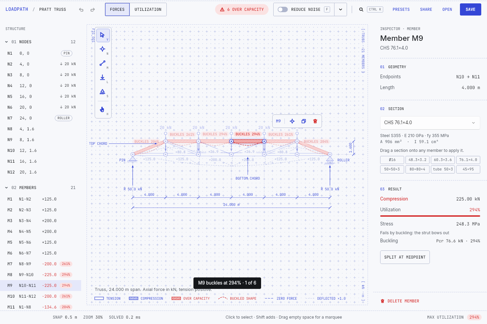
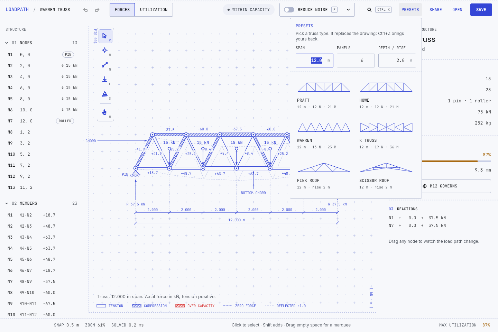

# Loadpath

A desktop workbench for 2D trusses that solves as you draw. Place nodes, connect them, pin some to the ground, hang loads, and every member shows the force it carries, its utilization, and the deflected shape. Drag a node and the whole load path re-solves on every pointer move.

Built with Uno Platform (`Uno.Sdk 7.0.0-dev.115`, Skia renderer, SkiaSharp 4) for five heads: desktop (Windows, macOS and Linux through Skia), Windows App SDK, WebAssembly, Android and iOS. It follows the system theme (a light blueprint sheet or a dark drafting table), lays itself out for phones, tablets and desktops, and edits by mouse and keyboard or by touch. The product and interaction design are in [`SPEC.md`](SPEC.md); this file covers what shipped, how it is built, and how it was validated.


## Run

```powershell
dotnet build Loadpath/Loadpath.csproj -f net10.0-desktop -p:LoadpathTargetFrameworks=net10.0-desktop
dotnet run --project Loadpath/Loadpath.csproj -f net10.0-desktop -p:LoadpathTargetFrameworks=net10.0-desktop
dotnet test Loadpath.Tests/Loadpath.Tests.csproj
```

`LoadpathTargetFrameworks` limits the app to one head, so a build needs only that head's workload. The other heads: `net10.0-browserwasm` (`wasm-tools` workload), `net10.0-android`, `net10.0-ios` (macOS) and `net10.0-windows10.0.19041` (Windows, x64 or ARM64). CI (`.github/workflows/ci.yml`) builds all five.

In Debug, set `APP_NO_HOTDESIGN=1` to skip `UseStudio()` when no DevServer is reachable (headless runs).

## What it does

| Capability | How it shows up |
|---|---|
| Live analysis | Direct stiffness solve on every edit, sub-millisecond for the samples. Status chip in the title strip, max utilization in the status bar. |
| Force ribbons | Member width scales with axial force; copper is tension, steel-blue is compression, and compression members carry a dark core line so sign is never color-alone. Overstressed members turn red with hatch ticks. |
| Tools | `V` select, `N` node (click a member to split it), `M` member (chains; click empty space to add a node), `L` load (click for 10 kN down, drag from a node to aim), `S` support (cycles pin → roller → none), `H` pan or hold `Space`. |
| Selection | Click, `Shift`-click, marquee (`Alt` selects what touches), `Ctrl+A`. The floating bar above a selection offers support, load, split, duplicate, delete. |
| Manipulation | Drag nodes or members with grid snap, alignment guides, `Shift` axis lock, `Alt` to disable snapping. Arrow keys nudge, `Shift` ×5. Load arrow tails are handles. |
| Inspectors | Summary, node (position, support, load fields), member (section, material, force, stress, utilization bar, buckling check), mixed (bulk actions). Sections drag from the inspector onto members. |
| Outline | Nodes and members with support badges and signed forces; click selects, hover highlights on canvas. |
| Display modes | `1` forces, `2` utilization ramp, `3` deflected ghost with exaggeration slider, `4` labels, `5` reactions. |
| Commands | Every action is an `AppCommand` with one shortcut label. `Ctrl+K` opens a searchable palette; right-click opens element-specific menus. |
| Undo/redo | Every mutation is a reversible edit. Drags coalesce into one entry. `Ctrl+Z`, `Ctrl+Y`. The history remembers the save point, so undoing back to the saved state clears UNSAVED; branching away from it keeps the document dirty. |
| Persistence | `.loadpath` JSON documents (save, save as, open), autosave restored on launch, view options persisted. |
| Share | `SHARE` or `Ctrl+Shift+C` copies a one-line share code (`LP1.` + base64url of the deflated JSON, about 460 characters for the Warren sample). `Ctrl+Shift+V` (or "Paste design" in the palette or empty state) loads a code, a code inside a chat message, or raw `.loadpath` JSON. Pasting is one undo step. Without a clipboard the code goes to `~/Documents/Loadpath/<name>.share.txt` and paste reads it back. |
| Presets | `PRESETS` opens a flyout with Pratt, Howe, Warren, K, Fink and scissor trusses, generated from span, panels and depth (rise for roofs), each with a live thumbnail. A preset ships with supports, panel-point loads (5 kN/m deck for bridges, 2 kN/m for roofs) and sections, so it solves at once. Loading one is undoable; the palette lists each preset at its defaults. |
| Failure highlighting | Members over capacity carry a red pill that names the mode: `BUCKLES 294%` or `YIELDS 118%` (the pill drops the verb when crowded). A member failing by buckling also gets its first Euler mode drawn beside it as a dashed red bow, with a legend entry. The summary inspector lists every failure worst first, with the force against Pcr or the stress against fy; a row selects its member. `J` steps through the failures, with a toast giving the position ("2 of 6"). |
| Upsize | `U`, the inspector's UPSIZE FAILING MEMBERS button, or the palette gives every failing member the lightest library section that carries it below 95 % utilization, as one undo step. A member keeps its material when that material has a working section. Redundant trusses are re-solved and resized until they settle. The toast reports the count and added mass ("Upsized 6 members · +157.3 kg"), and names any member no library section can carry. A passing member changes only if the upsize itself pushes it above 95 % (load moves in a redundant truss); one that was already near its limit and is not made worse keeps its section. |
| Lighten | `Shift+U`, LIGHTEN MEMBERS in the summary inspector, or the palette gives members the lightest same-material section that keeps every member under 95 % (or under its own utilization, if it was already above), as one undo step. It runs only when nothing fails, tries the heaviest members first and re-solves after each change, and leaves zero-force members alone because they often brace the frame. The toast reports the mass saved and the new max utilization: the Warren sample drops from 252 to 128 kg at 89 %. |
| States | Empty-state invitation with three samples, mechanism banner when the structure can move, a warning when parts are not connected to a support (they are left out of the solve instead of failing it), toasts for refused actions. |






## Architecture

```
Loadpath.Core/      net10.0 class library, no UI dependency
  Model/            StructureDocument, Node, Member, Section, Material
  Analysis/         TrussSolver (direct stiffness), LinearSolver, AnalysisResult, SectionSizer (upsize failing members, lighten the rest)
  Editing/          IEdit, EditHistory (undo/redo, coalescing, transactions), edits
  Selection/        SelectionSet
  Viewport/         Viewport (world ↔ screen, zoom-at-point, fit), PinchGesture
  Geometry/         Vec2, Bounds, HitTester (mouse and touch radii), SnapEngine, GridSteps
  Input/            TouchTracker (tap, drag, long press, pinch arbitration)
  Serialization/    DocumentSerializer (JSON v1), ShareCode (LP1. text codes)
  Samples/          Warren, cantilever, Howe roof; TrussPresets (parametric Pratt, Howe, Warren, K, Fink, scissor)
Loadpath/           Uno single-project app
  Presentation/     EditorEngine (imperative), EditorModel (MVUX states, feeds, commands), Records, ViewOptions
  Commands/         AppCommand, CommandRegistry (shortcut parsing)
  Workspace/        WorkspaceView (SKCanvasElement), WorkspaceRenderer, RenderSnapshot, WorkspaceInteraction, Tools/
  Views/            TitleStrip, ToolRail, InspectorPanel, OutlinePanel, StatusBar, CommandPalette
  Controls/         Icon, ToolButton, NumberField, UtilizationBar, KeySink, IconLibrary, Converters
  Services/         FileService, SettingsService
  Themes/           Tokens (Light and Dark), Layout (spacing, sizes, the responsive layout), MotionTokens, Icons, Controls
Loadpath.Tests/     xunit: solver against method-of-joints values, mechanism detection, history, geometry, serializer
```

**Decision: MVUX for the presentation layer, an imperative engine for the document.** `EditorModel` is a `partial record` whose states and feeds carry immutable records (`EditorStatus`, `InspectorContent`, `OutlineItem`, `PaletteItem`); the generated `EditorViewModel` is the page's DataContext and every view binds with `{Binding}`. Buttons bind generated commands; undo and redo are feed-gated (`Command.Create(b => b.Given(Status).When(s => s.CanUndo)...)`). `EditorEngine` owns the document, undo history, selection, viewport and tools, and raises events the model projects into states, because a solve on every pointer move cannot copy an immutable document per frame. Tradeoff: two layers, and a plain `ViewOptions` mirror of the option states for the renderer.

**Decision: one `SKCanvasElement` for the workspace, XAML for everything contextual.** Ribbons, labels, supports, guides and adorners must be pixel-registered with the structure, so they are Skia. The floating bar, banners, toasts and the drag ghost are XAML on an overlay layer positioned through the viewport transform. The renderer reads a `RenderSnapshot` built on the UI thread and holds no per-frame allocations beyond paths. There is no `CompositionTarget.Rendering` subscription; viewport animations run a timer only while moving.

**Decision: Fluent plus the app's own tokens; Uno Toolkit for responsive layout only.** The visual system is custom (blueprint drafting sheet, Inter for UI, JetBrains Mono for every number, hairlines instead of shadows), so the app carries its own tokens and control styles on top of Fluent (`XamlControlsResources`) instead of restyling a theme. No Material. The Toolkit (`UnoFeatures` `Toolkit`) is referenced for `utu:Responsive` and `ResponsiveView`; `ToolkitResources` is not merged, so it adds no control styles. This reverses the earlier "no Toolkit" decision.

**Decision: two themes, one identity.** Every colour role exists for Light (the blueprint sheet: paper `#F7F8FB`, near-black ink, blueprint-blue structure) and Dark (a drafting table at night: blue-slate paper `#10141B`, chalk ink, the structure in a lighter blueprint blue `#8FA0FF`). Views use `{ThemeResource}`; the canvas palette and the brush-key converters read the same tokens for the window's theme and re-read them on `ActualThemeChanged`. The app follows the system by default; the `⋯` menu (and three palette commands) pin Light or Dark, and the choice is saved with the view settings. Text passes 4.5:1 in both themes (InkTertiary moved from 3.0:1 to 5.5:1 on light). Dark is keyed `Default`, so Windows High Contrast falls back to it instead of failing to resolve.

**Decision: one responsive layout for the workbench.** `Themes/Layout.xaml` defines the app's only `utu:ResponsiveLayout` as `DefaultResponsiveLayout` (Normal 600, Wide 1100, Widest 1240): a docked 336 px inspector needs 1100 px to leave the sheet usable, and the docked outline docks from 1240 px as it always did. Widest shows outline, canvas and inspector; Wide docks the inspector with the outline as its second tab; Normal makes the inspector a side sheet over the canvas; Narrow (phones) turns the tools into a 44 px strip under the drawing, the inspector into a bottom sheet and moves secondary commands into the title's `⋯` menu. `Ctrl+\` and the title's inspector button toggle whichever the layout has. Tradeoff: Loadpath's breakpoints differ from the Toolkit defaults the other samples use.

**Decision: touch edits through the same tools.** A finger behaves like the left mouse button, but its press is held back until it moves (drag), lifts (tap) or rests (long press, the context menu), so a second finger can turn the touch into a pinch-zoom and pan before any tool acts. Fingers hit-test with 22 px radii (mouse keeps 6 to 9 px). A multi-select toggle in the floating bar stands in for Shift, the free-placement tool for Alt.

**Decision: detached parts are tolerated.** The solver finds connected components; a component with no support is excluded and reported instead of making the whole solve singular. A structure that is genuinely a mechanism still reports as one.

## Validation

- Themes, layouts and touch: Release desktop, Android and WebAssembly builds have 0 warnings and 0 errors; 102 tests pass (11 new: touch hit radii, the touch tracker's tap / drag / long press / pinch arbitration, the pinch anchor and clamp). Under Xvfb the Warren sample with a member selected was captured at 360, 599, 600, 800, 1080, 1099, 1100, 1240 and 1920 px wide, Light and Dark, with the inspector sheet closed, open and on its outline tab, each in one launch live-resized through the widths. With `LOADPATH_TOUCH=1` the mouse drove the touch path: a tap 18 px from a node selects it, a long press opens the node menu with 44 px rows, a one-finger drag moves a node, the multi-select toggle adds a second node. The overflow menu, the theme switch, the presets and layer sheets capped to a 360 px window, `Ctrl+\` on a phone, and the close prompt (Cancel keeps the window, Discard closes it) were driven with `xdotool`. Pinch and two-finger pan are covered by unit tests only: `xdotool` has a single pointer. The published WebAssembly build starts in Chromium at 390 x 844 and 1440 x 900 and loads the Warren sample. The WinAppSDK and iOS heads cannot build on Linux and are left to CI.
- Share, presets and failures (Stage 5 of `SPEC.md`): share codes round-trip every sample exactly, decode from inside surrounding text and from raw JSON, and refuse empty, foreign, truncated and corrupt input with a readable reason. Every preset at four parameter sets (defaults, small, odd panel count, 16 panels) solves with no detached parts, spans exactly the requested width, and balances its applied load with its reactions; defaults stay below full utilization; Pratt diagonals are in tension and Howe diagonals in compression. A slender strut fails by buckling, an overloaded tie by yield, and failures sort worst first. Section sizing brings an overloaded Pratt within capacity, changes only failing members in a determinate truss, picks the lightest working section per material, converges on a redundant K truss without leaving a touched or pushed member above 95 %, leaves a passing structure alone and reports loads beyond the library. Lighten saves mass without raising any member past its limit, keeps material and zero-force members, refuses while something fails, converges on a redundant truss, and is idempotent. The undo history's save point is clean after undo or redo back to it, dirty after branching away or extending the saved drag, and survives a history clear. An overloaded timber Fink upsizes in timber and an oversized one lightens in timber. 91 test cases in total.
- Runtime (Stage 5): under Xvfb, an overloaded Pratt (`LOADPATH_PRESET=pratt:24,6,1.6`) shows mode pills, buckled bows, the legend entry and the inspector failure list; `J` cycles with a position toast; clicking a failure row selects its member. The presets flyout was driven end to end (span set to 30 m, K truss loaded, `Ctrl+Z` restored and refit the previous structure). Share → New → Paste round-tripped the Howe roof through the real X11 clipboard, and `Ctrl+Z` undid the paste.
- 21 unit tests: a triangle truss matches method-of-joints forces and reactions to three decimals; a square without a diagonal is a mechanism; detached parts are left out; drags coalesce; delete/split/duplicate revert exactly; samples serialize round-trip and all solve below full utilization.
- Runtime: the app was driven under Xvfb with `xdotool` (`tools/drive.sh`) through select, drag with live re-solve, undo, node and member chaining with guides, load vector drag, support cycling, marquee delete, load-handle drag, number-field editing, outline selection and collapse, bulk support and section actions, section drag-and-drop, the combo box, the palette (search, arrow keys, Enter), context menus, display modes, save to disk and autosave restore. The same pass was repeated after the MVUX conversion. Screenshots in `docs/` come from those runs.
- Release build has zero warnings.
- A UI craft pass (critique checklist, two widths, two heights, every display mode) brought control heights from five values to three (26 px chrome, 24 px status-bar segments, 32 px tool rail), moved arrow labels off the members, added the exaggeration readout, replaced the macOS `⌃K` glyph with `Ctrl+K`, and made the status bar drop the cursor readout below 960 px so the display toggles and max utilization stay whole.

Fixture hooks make headless captures deterministic: `LOADPATH_SAMPLE=warren|cantilever|roof`, `LOADPATH_PRESET=pratt` or `pratt:24,6,1.6` (span, panels, depth), `LOADPATH_RESET=1` (ignore settings and autosave), `LOADPATH_SELECT=n4,m12`, `LOADPATH_MODE=utilization,deflection,reactions,nolabels`, `LOADPATH_TOOL=member`, `LOADPATH_PALETTE=1`, `LOADPATH_TOAST=text`, `LOADPATH_EDIT=unsupported|overload`, `LOADPATH_TRACE=path`, `LOADPATH_THEME=light|dark|system`, `LOADPATH_SHEET=1` (open the inspector sheet), `LOADPATH_TAB=outline`, `LOADPATH_MULTI=1`, `LOADPATH_FREE=1`, `LOADPATH_TOUCH=1` (route the mouse through the touch path, for headless touch checks). `LOADPATH_SAMPLE`, `LOADPATH_RESET` and `LOADPATH_NO_RESIZE` work in every build; the rest are Debug only.

## Platform notes

- On desktop the window is sized at launch through `ApplicationView.PreferredLaunchViewSize`; resizing after creation raced the X11 Skia surface and produced a stale first layout. A self-healing check still nudges the size if the layout ever disagrees with the frame. WinAppSDK resizes its `AppWindow` once at the display scale; WebAssembly, Android and iOS fill the browser or the screen.
- Files are read and written through `StorageFile` streams, never `file.Path`: a picked file is a browser handle or temporary copy on WebAssembly (saves go through `CachedFileManager`, which starts the download in browsers without the File System Access API) and a content URI on Android. WinAppSDK pickers get the main window as their owner.
- On Linux the file pickers go through the xdg-desktop-portal. Without a session bus the app saves to `~/Documents/Loadpath` and says so in a toast. Heads with no Documents folder (WebAssembly, Android, iOS) fall back to the app's local folder.
- Share uses `Windows.ApplicationModel.DataTransfer.Clipboard`, which works on the X11 host; desktop and WinAppSDK also `Flush` it so the code outlives the app. Any clipboard exception falls back to a `.share.txt` file in the fallback folder, and a toast says so when there is no folder either.
- `ItemsWrapGrid` is not implemented in Uno, so the preset tiles use `ItemsRepeater` with `UniformGridLayout`.
- Mouse-wheel zoom uses `PointerWheelChanged`. Synthesized X11 button-4/5 clicks arrive as plain presses on this host, so wheel zoom was not exercised headlessly; `Ctrl+=`, `Ctrl+-`, `Ctrl+0`, `Ctrl+1` and `F` were.
- `SKCanvasElement` ignores `UIElement.Opacity`; dimming is baked into the paints.
- On Uno 7 `SKCanvasElement` derives from `Grid`, which is not hit-testable without a background; the workspace sets a transparent `Background` so it receives pointer input (and keeps keyboard focus on the key sink).
- Mouse-wheel zoom is off on Android and iOS, which report no wheel delta; `Ctrl+=`, `Ctrl+-`, `Ctrl+0` and Fit remain. Cursor shapes are set on desktop, WebAssembly and WinAppSDK only.
- Documents and settings serialize through source-generated `JsonSerializerContext`s: the trimmed WebAssembly head turns reflection-based `System.Text.Json` off.
- Load and reaction arrows have a fixed pixel length, so where their labels are clear depends on zoom. The renderer keeps the label boxes drawn each frame and gives an arrow label the first of four spots (beyond the tail, further beyond, beside the tail outward, beside it inward) that misses them.
- MVUX generator notes: records carried by feeds are plain `partial record`s (no `required` members, no record structs), colors travel as resource keys resolved by a converter, and a `readonly record struct` with an `Id` property must not be `partial` or the key-equality generator emits a non-partial duplicate.
- MVUX runs generated commands and `ForEach` callbacks on a thread-pool thread. Anything that mutates the document (and therefore raises events that reach XAML) is posted back to the UI dispatcher through `EditorModel.Ui(...)`; without it the first edit of a transaction lands and the rest throw "dependency property system should not be accessed from non UI thread".
- When a focused element leaves the tree (a collapsing inspector panel, the closing palette) keyboard events lose their target; the page moves focus back to an invisible `KeySink` on selection changes and palette close.
